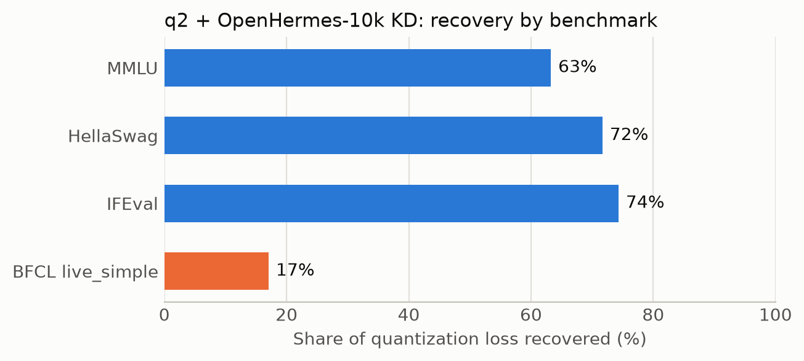
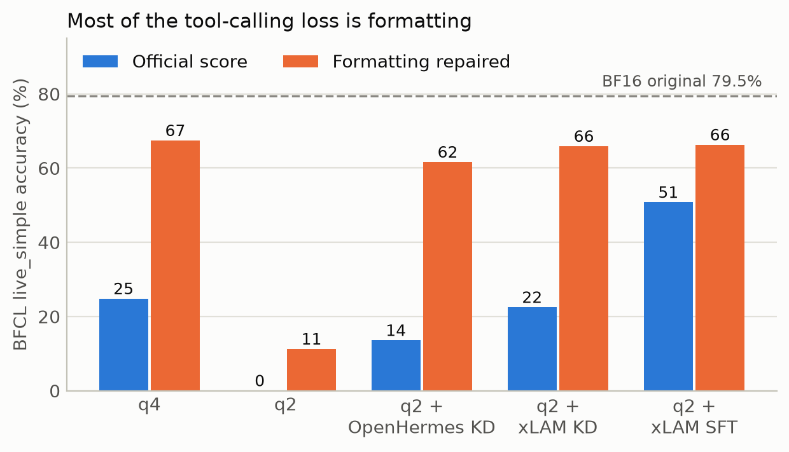
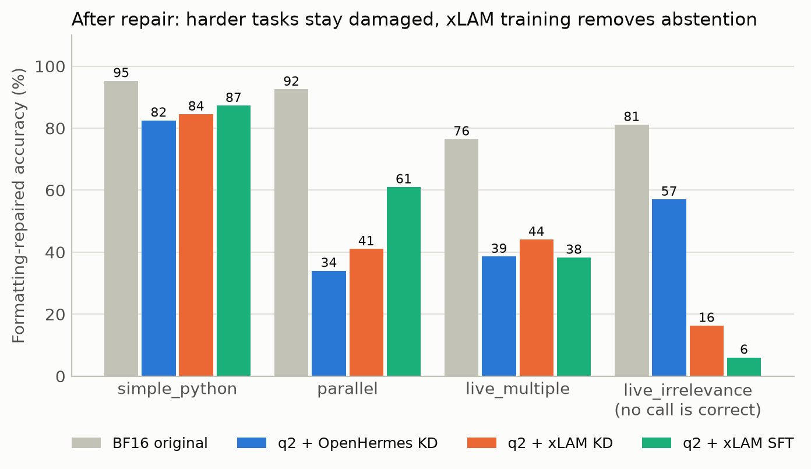

# Progress Report: Does Quantization Recovery Restore Tool Calling?

**Repository:** https://github.com/hassaanmuzammil/quantization-recovery-tool-calling
**Date:** 2026-11-23

## 1. Project in brief

Quantizing a language model (storing its weights at very low precision)
makes it smaller and cheaper to run, but damages its abilities.
**Recover-LoRA** (arXiv 2606.04238) is a method for undoing that damage. It
quantizes part of the model to 2 bits, then trains small adapter layers so
that the damaged model imitates the original. The paper reports recovering
80–95% of lost accuracy, but only on general benchmarks such as MMLU.

Our project asks whether that recovery also holds for **tool calling**: given
a user request and a list of available functions, the model must choose the
right function, fill in its arguments as valid JSON, and decline when no
function fits. Our two research questions:

- **RQ1:** Does a model recovered with Recover-LoRA regain tool calling as
  well as it regains general ability?
- **RQ2:** Does training the recovery on tool-calling text, instead of
  general text, recover more tool-calling ability?

## 2. Terms used in this report

**Model and quantization**

- **Base model:** Qwen3-4B-Instruct-2507, a 4-billion-parameter model with
  native function-calling support. All experiments so far use it.
- **BF16 (original):** the unmodified model at its normal 16-bit precision.
  It is the upper bound every other model is compared against.
- **gate/up projections:** two of the three weight matrices in each
  feed-forward (MLP) block of the transformer. Following Recover-LoRA, only
  these are quantized; the rest of the model stays at 16 bits.
- **q2 / q4:** the base model with its gate/up projections quantized to 2
  bits / 4 bits. Each weight can then take only 4 (q2) or 16 (q4) distinct
  values, shared within groups of 32 weights ("group size 32"). q2 is the
  setting studied in the paper and our main focus; q4 is a milder reference
  point.

**Recovery methods**

- **LoRA adapter:** a small set of trainable low-rank matrices added on top
  of frozen weights. We add rank-64 adapters to the quantized gate/up
  projections; only the adapters are trained.
- **KD (knowledge distillation):** the recovery method from Recover-LoRA.
  The original BF16 model is the *teacher* and the damaged q2 model is the
  *student*. Both read the same text, and the adapter is trained so the
  student's next-token probabilities match the teacher's. No correct
  answers (labels) are needed.
- **SFT (supervised fine-tuning):** ordinary training on labelled examples:
  the adapter is trained to reproduce the correct answer directly, with no
  teacher.

**Training data**

- **OpenHermes-10k:** the first 10,000 examples of OpenHermes, a general
  instruction-following dataset (no tool calling).
- **xLAM-10k:** the first 10,000 examples of xLAM, a function-calling
  dataset. Each example contains function definitions, a user query and the
  correct call, formatted in Qwen's native tool-calling format.

Model names combine these. For example, **q2 + xLAM-10k KD** is the q2 model
with a LoRA adapter trained by distillation on xLAM-10k.

**Benchmarks and metrics**

- **MMLU, HellaSwag:** general knowledge and commonsense multiple-choice
  benchmarks. The model only ranks fixed answer options; it never writes
  free text.
- **IFEval:** tests whether free-text answers follow explicit instructions
  (e.g. "answer in under 50 words").
- **BFCL v4** (Berkeley Function Calling Leaderboard): the tool-calling
  benchmark. We use six categories:
  - `simple_python` (400 cases): one function offered, one call expected.
  - `multiple` (200): several functions offered, pick one.
  - `parallel` (200): several calls needed for one request.
  - `live_simple` (258) and `live_multiple` (1,053): the same tasks with
    real user-submitted queries and functions, which are harder.
  - `live_irrelevance` (884): no offered function fits, so the correct
    answer is to make no call.
- **Official score:** the BFCL score as the benchmark computes it. A call
  that is correct in content but malformed (e.g. broken JSON) counts as
  wrong.
- **Formatting-repaired score:** our own diagnostic, not an official
  result. A script rewraps each recoverable call in correct tool-call tags,
  without changing the function name or arguments, and the result is
  re-scored. It separates *format* damage (the call is right but malformed)
  from *content* damage (wrong function or arguments).
- **Recovery %:** the share of the lost score that was won back:
  (recovered − q2) / (BF16 − q2) × 100.
- **McNemar test:** a significance test for two models evaluated on the
  same test items.

## 3. Experiments so far

All training runs use the same recipe: rank-64 LoRA on gate/up, 10,000
examples, 1 epoch, learning rate `5e-4`, one NVIDIA H100 (80 GB). Full
details are in `docs/experiments.md`

| Model | Purpose | Status |
|---|---|---|
| BF16 original | Upper bound | Done |
| q2 | Damage baseline | Done |
| q4 | Milder damage reference | Done |
| q2 + OpenHermes-10k KD | Faithful Recover-LoRA reproduction (RQ1) | Done |
| q2 + xLAM-10k KD | Same recipe, tool-calling data (RQ2) | Done |
| q2 + xLAM-10k SFT | Can the 2-bit model learn tool calling at all with labels? | Done |

### General benchmarks

| Benchmark | BF16 | q4 | q2 | q2 + OpenHermes-10k KD | Recovery % (q2) |
|---|---:|---:|---:|---:|---:|
| MMLU (accuracy) | 70.55% | 69.75% | 48.48% | 62.43% | 63% |
| HellaSwag (normalized accuracy) | 69.10% | 68.98% | 52.11% | 64.29% | 72% |
| IFEval (prompt-level strict) | 83.36% | 82.81% | 49.54% | 74.68% | 74% |
| BFCL `live_simple` (official) | 79.46% | 24.81% | 0.00% | 13.57% | 17% |

BFCL `live_simple` is included for comparison; the full BFCL results are
below.

### BFCL tool calling (official score / formatting-repaired score)

| Model | `simple_python` | `multiple` | `parallel` | `live_simple` | `live_multiple` | `live_irrelevance` |
|---|---:|---:|---:|---:|---:|---:|
| BF16 original | 95.25 | 93.00 | 92.50 | 79.46 | 76.45 | 81.11 |
| q4 | 45.75 / 87.25 | 53.50 / 86.00 | 45.50 / 76.50 | 24.81 / 67.44 | 27.92 / 63.34 | 86.20 / 59.05 |
| q2 | 0.00 / 28.50 | 0.00 / 27.00 | 0.00 / 1.00 | 0.00 / 11.24 | 0.00 / 3.13 | 100.00 / 81.22 |
| q2 + OpenHermes-10k KD | 33.75 / 82.50 | 33.00 / 80.50 | 0.50 / 34.00 | 13.57 / 61.63 | 11.11 / 38.56 | 92.31 / 57.01 |
| q2 + xLAM-10k KD | 25.00 / 84.50 | 29.00 / 84.00 | 10.00 / 41.00 | 22.48 / 65.89 | 18.71 / 44.06 | 74.10 / 16.29 |
| q2 + xLAM-10k SFT | 67.75 / 87.25 | 61.50 / 80.00 | 46.50 / 61.00 | 50.78 / 66.28 | 28.96 / 38.27 | 35.63 / 6.00 |

All values are percentages. BF16 is shown once because repair changes its
score by at most 2 cases. A high official `live_irrelevance` score can be
misleading: a model whose calls are all malformed "makes no call" and so
scores well. The repaired score is the better measure of true abstention.

## 4. Key findings

**1. Recovery is strongly capability-dependent (RQ1).** The faithful
reproduction recovers 63–74% of the loss on MMLU, HellaSwag and IFEval, but
only 17% on BFCL `live_simple` (0.00% → 13.57%, against 79.46% for BF16).



*Figure 1. Share of the q2 damage won back by the faithful Recover-LoRA
reproduction. The same adapter recovers about three-quarters of the loss
on general benchmarks but under a fifth on tool calling.*

The same split appears in the damage itself, before any recovery. 4-bit
quantization leaves the general benchmarks almost untouched (within 0.8
points of BF16 on MMLU, HellaSwag and IFEval) but cuts the official BFCL
`live_simple` score from 79.46% to 24.81%. Judged only on general
benchmarks, q4 would look nearly lossless.

**2. Most of the tool-calling loss is formatting, not knowledge.** Recovered
models usually choose the right function and arguments but end the call
incorrectly, most often with an extra `}` after the JSON object:

```text
<tool_call>
{"name": "github_star", "arguments": {"repos": "ShishirPatil/gorilla", "aligned": true}}}
```

Once formatting is repaired, the OpenHermes KD model reaches 61.63% on
`live_simple`, about 78% of BF16. q4 makes the same error without any
training, so it is caused by quantization, not by recovery.



*Figure 2. BFCL `live_simple`: official score (blue) vs the same outputs
after formatting repair (orange). The gap between each pair of bars is
format damage; the gap between the orange bar and the BF16 line is content
damage. This figure also supports Findings 3 and 4.*

**3. Tool-calling training data helps only modestly (RQ2).** With the same
budget, xLAM KD recovers 28% of the lost `live_simple` score compared with
17% for OpenHermes KD (McNemar p = 0.004). Neither fixes the extra-`}`
error, even though every xLAM training example ends its calls correctly.

**4. Formatting is a limit of KD; content is a limit of the 2-bit model.**
SFT on the same xLAM data more than doubles the official `live_simple`
score of KD (50.78% vs 22.48%), because it fixes most formatting errors.
After repair, however, SFT and KD are equal (66.28% vs 65.89%): even with
correct labels, the quality of the calls themselves does not improve.

**5. Content damage remains on harder tasks, and xLAM training removes
abstention.** After repair, q2 models reach 80–87% on `simple_python` and
`multiple` (BF16: 93–95%), but only 34–61% on `parallel` and 38–44% on
`live_multiple`. Because every xLAM example contains a call, models trained
on it almost never decline: repaired `live_irrelevance` falls to 16% (KD)
and 6% (SFT), against 81% for BF16.



*Figure 3. Formatting-repaired accuracy on four BFCL categories. Single
calls are close to BF16; multi-call (`parallel`) and many-function
(`live_multiple`) tasks are not. On `live_irrelevance`, higher means the
model correctly declined to call.*

**6. Recovered general scores match the paper despite a different
quantization recipe.** Recover-LoRA does not give its exact 2-bit
quantization recipe (quantizer, scale and zero-point handling), so we could
not reproduce its quantized model exactly. We used our own: asymmetric
min–max round-to-nearest in groups of 32 weights. Our q2 model is therefore
damaged differently from the paper's. The paper's Table 4 also reports
recovery with OpenHermes-10k, the same data we used, so the two runs can be
compared directly:

| Benchmark | Source | BF16 | q2 (before recovery) | After OpenHermes-10k KD | Recovery % |
|---|---|---:|---:|---:|---:|
| MMLU (accuracy) | Paper | 68.3% | 24.5% | 61.2% | 83.7% |
| | Ours | 70.55% | 48.48% | 62.43% | 63.3% |
| HellaSwag (accuracy) | Paper | 52.2% | 28.0% | 48.3% | 83.9% |
| | Ours | 52.55% | 39.99% | 48.31% | 66.2% |

The HellaSwag rows use plain accuracy, not the normalized accuracy used
elsewhere in this report. The paper does not name its metric, but its BF16
score (52.2%) matches our plain accuracy (52.55%), not our normalized
accuracy (69.10%).

After recovery, the two models land in the same place: 48.3% vs 48.31% on
HellaSwag and 61.2% vs 62.43% on MMLU. This happens even though the
quantization recipes differ, and the paper's adapter uses rank 32 and
learning rate `1e-4` while ours uses rank 64 and `5e-4`.

**Why our recovery % is lower than the paper's 80–95%.** Recovery % is
(recovered − q2) / (BF16 − q2), so it depends on how far the quantized
model fell, not only on where it recovered to. The paper's quantization
damages the model much more than ours: its q2 model scores 24.5% on MMLU,
the level of random guessing on four options, against 48.48% for ours.
Both models then recover to the same score, so the paper's larger gap
turns the same recovery into a larger percentage. Our lower figure
reflects a milder quantization, not a weaker recovery.

**An upper bound for 2-bit recovery?** Two different quantization recipes
and two adapter configurations recovering to the same score suggests an
upper bound on what this kind of recovery can reach for a 2-bit gate/up
model, however the model was quantized. This agrees with Finding 4, where
even labelled training could not raise call content above the same level.
It is a hypothesis, not yet a result: it rests on one run each, and the
paper names its teacher only as "Qwen3-4B" while we use
Qwen3-4B-Instruct-2507.

## 5. Deviations from the proposal and open issues

- **Quantization recipe:** the paper does not specify its exact 2-bit
  recipe, so our q2 model is not an exact reproduction of theirs (see
  Finding 6).
- **KD data is public, not generated by the teacher:** the proposal (and
  Recover-LoRA) uses text the teacher model generates itself: general text
  for the reproduction, and tool-use exchanges from hand-written function
  definitions for the tool-calling run. Generating 10,000 examples with the
  teacher took too long on our H100 allocation, so we used public datasets
  instead: OpenHermes-10k for general text and xLAM-10k for tool calling.
  Self-generated data is used because the teacher is good at producing it,
  and a teacher that handles its training text well gives the student a
  better signal to imitate. OpenHermes keeps that property: it is a widely
  used instruction-tuning dataset that the teacher has likely been trained
  on and handles well. Recover-LoRA itself reports recovery with
  OpenHermes-10k alongside its self-generated data (Table 4), with similar
  results. The trade-off for tool calling is that xLAM changes
  both the data source and the domain between the two KD runs, so the
  difference between them cannot be attributed to domain alone.
- **SFT control:** the proposal planned SFT on the BF16 model as a positive
  control. We ran SFT on the q2 model instead, which tests whether the
  2-bit model can learn tool calling at all.
- **Adapter settings:** LoRA rank 64 and learning rate `5e-4`. Recover-LoRA
  uses rank 32 and `1e-4`, and the proposal planned 1e-6 to 1e-5.
- **Not done yet:** multiple seeds (every result is a single run), the
  LoRA rank ablation (16 vs 64), the chance-corrected metric, the full
  per-error-type breakdown, general benchmarks for the xLAM models, and a
  second model.

## 6. Possible next directions

**A. Breadth: replicate on a second model family.** Repeat the main
pipeline on another architecture such as Mistral, Gemma, Granite 4 Micro or
Phi-4-mini, to see whether the findings (capability-dependent recovery,
formatting-dominated damage, the extra-`}` error) are general or specific
to Qwen3.

**B. Depth: push q2 recovery further on Qwen3-4B.** Each option targets a
specific finding:

- **On-policy distillation:** train on outputs the *student* generates,
  scored by the teacher. In standard KD the student only reads teacher
  text, so it never sees its own mistakes, such as the extra `}`.
- **Mixed training data:** add examples where no call is correct, or mix
  in general text, to restore abstention.
- **Adapter capacity and data scale:** higher LoRA rank, adapters on more
  layers, more data or more epochs, to test whether the content limit in
  Finding 4 is due to adapter size.
- **Combined loss:** KD plus a small SFT term, to keep distillation's
  benefits while fixing the format.
- **Constrained decoding:** force valid output structure at inference
  time, as a cheap baseline showing how much training is needed beyond
  formatting.

**C. Complete the original plan:** add seeds, the rank ablation and the
remaining evaluations listed in Section 5.

## 7. Questions for feedback

1. With the remaining time, should we prioritize breadth (A), depth (B), or
   completing the original plan (C)?
2. If depth, which method seems most worthwhile? On-policy distillation is
   our first choice, since it targets the main error we observe.
3. If breadth, which second model would you recommend?
4. Is it acceptable to report our formatting-repaired score alongside the
   official BFCL score, given it is our own diagnostic?
5. Is using the public xLAM dataset for tool-calling KD acceptable, or
   should we generate the data with the teacher as the proposal describes?
6. Is the matching recovered scores in Finding 6 worth testing directly,
   for example by recovering models quantized with several different
   2-bit recipes and checking whether they converge to the same score?
